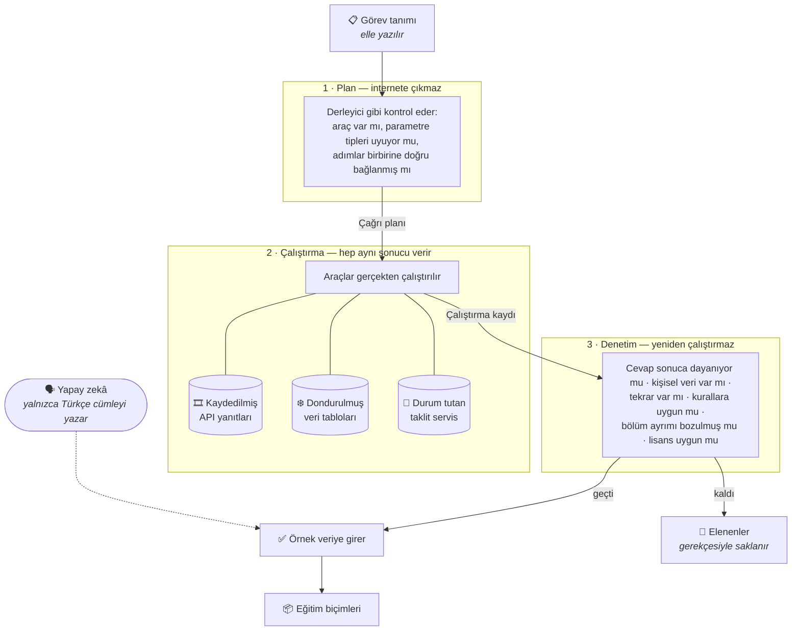

# ToolCall-TR

**A Verifiable Tool-Calling Data Generation Framework for Turkish and Turkey-Specific APIs**

Türkçe soru–araç çağrısı veri setleri üreten açık kaynak bir hat. Üretilen her
araç çağrısı **gerçekten çalıştırılır**, dönen sonuç kaydedilir ve ayrıca
denetlenir. Aynı girdi her zaman aynı sonucu verir.

> **Durum: ilk sürüm (v0.1) yayımlandı.** 200 doğrulanmış örnek
> (`turkey-200-v3`): 74 farklı görev, 15 veri kaynağı, 35 araç, 11 senaryo
> türünün hepsi. Eğitim ve test setleri arasında geçiş yok.
>
> **Bu küçük bir ilk sürümdür.** 200 örnek bir modeli eğitmeye yetmez; yöntemi
> ve veri biçimini incelemek için yayımlanmıştır. Hedeflenen 10.000–15.000
> örneklik sürüm henüz üretilmedi.
>
> 📦 **Veri seti:** [`bilalabic/toolcall-tr-pilot`](https://huggingface.co/datasets/bilalabic/toolcall-tr-pilot)

---

## Farkı ne

> **Veri setindeki her araç çağrısı gerçekten çalıştırıldı ve dönen sonuç
> kaydedildi. Hiçbir araç çıktısını bir yapay zekâ yazmadı.**

Benzer veri setlerinin çoğunda araçtan dönen cevap da yapay zekâya yazdırılır.
O zaman veri "biçim olarak doğru" olur ama içeriği uydurmadır. Burada yapay
zekâ yalnızca Türkçe kullanıcı cümlesini yazar; hangi aracın hangi
parametrelerle çağrılacağı koddan üretilir, gerçekten çalıştırılır ve ayrıca
denetlenir.

| | Mevcut TR veri setleri | ToolCall-TR |
|---|---|---|
| Kaynak | Çeviri veya İngilizce araç listesi | Gerçek API'ler |
| Araç çıktısı | Yapay zekâ yazmış | Gerçekten çalıştırılmış |
| Doğrulama | Biçim doğru mu | Biçim + çalıştırma + cevabın sonuca dayanması |
| Tekrarlanabilirlik | — | Aynı girdi hep aynı sonucu verir |

---

## Nasıl çalışır

Üretim üç aşamadan geçer ve bu aşamalar **hiçbir zaman tek adımda
birleştirilmez.** Planlama internete çıkmaz, çalıştırma her seferinde aynı
sonucu verir, denetim ise yalnızca kaydedilmiş çıktıyı okur.



**Neden bu kadar ayrı:** denetim aşaması, çalıştırma aşamasına erişemez. Erişse
"denetim sırasında sonucu yeniden üretme" kapısı açılırdı ve o an veri
doğrulanabilir olmaktan çıkardı. Bu kural kodda zorunlu tutulur; ihlal edilirse
otomatik kontroller hata verir.

**Yapay zekânın oku neden kesikli:** çünkü doğru cevabı o üretmiyor. Yalnızca
kullanıcının soracağı Türkçe cümleyi yazıyor. Hangi aracın çağrılacağı ve
sonucun ne olduğu tamamen koddan ve gerçek çalıştırmadan geliyor. Cümleyi yazan
model de tahminle değil ölçülerek seçildi; ayrıntı [`CLAUDE.md`](CLAUDE.md).

### Aynı girdi hep aynı sonucu verir

Canlı bir API her çağrıda farklı veri döndürür. Bu, doğrulanabilir bir veri
setiyle bağdaşmaz: bugün ürettiğiniz örneği yarın kimse aynı şekilde
üretemezse, "doğrulanmış" demenin anlamı kalmaz.

Çözüm, API yanıtlarını **bir kez kaydedip sonra hep o kayıttan okumaktır.**
Üretim ve testler internete hiç çıkmaz. Kayıtlar araç adına değil, gönderilen
HTTP isteğine göre saklanır — çünkü araç tanımları projede en sık değişen
şeydir; kayıtları onlara bağlasaydık her küçük değişiklikte tüm kayıtlar
kullanılamaz hâle gelirdi.

Buna dondurulmuş saat ve sabit tohumlu rastgelelik eklenince, üretimi ikinci
kez çalıştırdığınızda birebir aynı sonucu alırsınız.

---

## Veri kaynakları

15 kaynak, 35 araç — hepsi ilk sürümde gerçekten çağrıldı, katalogda durup
kullanılmayan araç yok.

| Kaynak | Sonuç nereden geliyor | Lisans |
|---|---|---|
| MET Norway hava durumu | Kaydedilmiş API yanıtı | CC BY 4.0 |
| GeoNames Türkiye | Dondurulmuş tablo | CC BY 4.0 |
| Frankfurter döviz kuru (`providers=ECB`) | Kaydedilmiş API yanıtı | ECB koşulları |
| USGS deprem | Kaydedilmiş API yanıtı | ABD kamu malı |
| Dünya Bankası göstergeleri (`source=2`) | Kaydedilmiş yanıt + alan filtresi | CC BY 4.0 + WB koşulları |
| GBIF biyoçeşitlilik | Kaydedilmiş yanıt (lisans filtreli) | CC0 1.0 + CC BY 4.0 |
| Wikidata | Kaydedilmiş API yanıtı | CC0 1.0 |
| Wikimedia / Crossref / GitHub | Kaydedilmiş yanıt, yalnızca künye alanları | Kaynağa özgü |
| Resmî tatiller | Dondurulmuş tablo | Kamu hukuku / resmî takvim |
| Hesaplama ve saat | Yerel hesap | Apache-2.0 |
| Sentetik takvim | Yerel taklit servis, **durum tutar** | Apache-2.0 |

**"Yalnızca künye alanları" sözde kalmıyor.** Hangi alanların alınacağı tek tek
listelenmiştir; listede olmayan hiçbir alan veriye giremez. Wikipedia'nın madde
özetleri farklı bir lisansa (CC BY-SA) tabi olduğu için alınmaz. GitHub'dan
yalnızca depo istatistikleri alınır; açıklama metni, README, issue/PR içerikleri
ve kullanıcı adları **alınmaz**. Bir test bunu sürekli denetler, böylece kaynak
taraftaki bir değişiklik lisanslı metni fark ettirmeden geri sokamaz.

**Durum takibi gerçekten çalışıyor.** Sentetik takvim üzerinde 31 örnek,
işlemin öncesindeki ve sonrasındaki durumu ayrı ayrı kaydeder; 17'sinde durum
fiilen değişir. Yani "önce onay iste, sonra kaydet" ve "kullanıcı vazgeçti"
akışları yalnızca anlatılmıyor — gerçek bir takvim üzerinde çalıştırılıp
sonucu doğrulanıyor.

---

## Kurulum

```bash
uv sync --all-extras
```

```bash
uv run pytest -q
```

Testler ve varsayılan üretim **API anahtarı olmadan** çalışır: API yanıtları
kayıttan okunur, Türkçe cümleler ise sabit şablonlardan üretilir. OpenAI
kullanmak isteğe bağlıdır — ayrıntı için
[`docs/OPENAI_INTEGRATION.md`](docs/OPENAI_INTEGRATION.md).

Yeni bir API kaynağı eklemek isterseniz kontrol listesi:
[`docs/ADDING_API_PROVIDER.md`](docs/ADDING_API_PROVIDER.md).

## Kullanım

Baştan sona üretim (internet gerekmez):

```bash
uv run toolcall-tr generate
```

Aşamaları ayrı ayrı çalıştırmak için:

```bash
uv run toolcall-tr build-registry && uv run toolcall-tr plan && uv run toolcall-tr run && uv run toolcall-tr validate
```

Rapor ve denetim:

```bash
uv run toolcall-tr quality-report && uv run toolcall-tr stats && uv run toolcall-tr cassette verify
```

Dengeli dağılım hedefiyle deneme üretimi:

```bash
uv run toolcall-tr generate-canary --profile smoke --target 100
```

`smoke` profili yalnızca hattın çalışıp çalışmadığını sınar; çıktısı tek başına
yayına hazır sayılmaz. `release` profili ise tekrarları engeller ve her kaydın
anlam, kural ve dil denetimlerinden geçmiş olmasını zorunlu tutar.

Hangi karardan, hangi senaryo türünden ve hangi zorluktan kaç örnek üretileceği
**API'ye hiç gidilmeden önce** planlanır. Bir örnek denetimden geçemezse, ret
gerekçesi aynı görevin bir sonraki denemesine düzeltme notu olarak verilir.

API yanıtlarını kaydetmek **ayrı ve bilinçli bir işlemdir**; normal komutların
hiçbiri internete çıkmaz:

```bash
uv run python scripts/record_met_cassettes.py
```

### Eğitim biçimleri

| Biçim | İçerik |
|---|---|
| `openai_call_only` | Yalnızca araç seçimi; sonuç ve final cevap yok |
| `openai_trajectory` | Baştan sona: çağrılar, dönen sonuçlar ve final cevap |
| `openai` / `sharegpt` / `xlam` | Yaygın kullanılan standart biçimler |

Her örnekte kısa bir karar gerekçesi bulunur. Bu, denetlenebilir birkaç
cümledir; modelin ham veya gizli düşünce zinciri hiçbir biçime eklenmez.

### Görülmemiş araç / kaynak üzerinde ölçüm

Varsayılan ayrım görev bazındadır: aynı görev hem eğitimde hem testte olamaz.
Daha zorlu bir ölçüm isterseniz `--holdout-profile unseen_tool` veya
`--holdout-profile unseen_provider` seçebilirsiniz — bu durumda test setindeki
araçlar ya da kaynaklar eğitimde hiç görülmemiş olur. Kesişim sıfır değilse
üretim durur ve sonuç ayrı bir raporda yayımlanır.

### Eğitime kapalı güvenlik testleri

`data/evaluation/security/` altında, araç çıktısına gizlice talimat gömülmüş
sentetik saldırı örnekleri vardır. Kullanıcının asıl isteği, güvenilmez araç
çıktısı, içine gömülen talimat ve beklenen doğru davranış ayrı alanlarda
tutulur.

Bu kayıtlar **eğitimde kullanılamaz** ve bu kural biçimin kendisi tarafından
zorunlu tutulur; yayın paketi, bu klasördeki bir dosyayı eğitim verisi olarak
işaretlemeyi reddeder.

---

## İlk sürüm (v0.1) — `turkey-200-v3`

**200 doğrulanmış örnek · 74 farklı görev · 15 kaynak · 35 araç · 0 elenen**

| Modelin kararı | | | Bölüm | Örnek |
|---|---|---|---|---|
| Bir araç çağır | 143 (%71,5) | | train | 140 |
| Doğrudan cevapla | 28 (%14,0) | | validation | 20 |
| Yapılamaz, reddet | 21 (%10,5) | | test | 40 |
| Eksik bilgiyi sor | 8 (%4,0) | | | |

**Örneklerin %28,5'inde hiç araç çağrılmıyor.** Bu tür veri setlerinde asıl zor
olan, modele aracı *ne zaman kullanmayacağını* öğretmektir.

11 senaryo türünün hepsi var: tek çağrı 68, zincirleme çağrı 30, reddetme 21,
doğrudan cevap 17, onay isteme 13, beklenen hata 13, kullanıcının vazgeçmesi 11,
paralel çağrı 11, soru sorma 8, boş sonuç 4, hatadan toparlanma 4. 30 örnek
karşılıklı konuşma biçimindedir.

Eğitim/test ayrımı **görev bazında** ve örnekler çoğaltılmadan **önce** yapılır.
Aynı görevin farklı yazılışları hep aynı bölüme gider; biri eğitimde biri testte
olamaz. Bu kurala uymayan tek görev yok.

### Neden 200'de duruldu

Daha büyük bir üretim denendi ve **elendi.** 1.000 örnek üretildi ama bunlar
yalnızca 20 farklı görevden geliyordu — yani her görev ortalama 50 kez
tekrarlanmıştı. Çeşitlilik çöktü: örneklerin %94,3'ü "sor, aracı çağır, cevabı
al" biçiminde kolay durumlardı ve 11 senaryo türünden 6'sında hiç örnek yoktu.

Kalite kontrolü buna "geçti" dedi. Sebebi şuydu: kontrolün kendi ayarı,
örneklerin en az %90'ının araç çağrısı olmasını *istiyordu.* Kontrol doğru
çalışıyordu, yanlış şeye bakıyordu.

Ders şu: sorun hız değil, **farklı görev sayısı.** 20 görevden 1.000 örnek
çeşitliliği bozdu; 74 görevden 200 örnek bozmadı. Hattın 1.000 ölçeğinde
çalıştığı ise bu koşuda kanıtlanmış oldu.

### Sıradaki: 10.000–15.000 örnek

Dengeli 10.000 örnek için yaklaşık 3.700 farklı görev gerekiyor; bugün elle
yazılmış 74 görev var. Bunları tek tek yazmak gerçekçi değil, o yüzden
görevleri şablonlardan otomatik türeten bir katman gerekiyor. Bu katman henüz
yazılmadı. Ayrıntı: [kalite kurtarma planı](docs/QUALITY_RECOVERY_PLAN.md).

---

## Kişisel veri politikası

Kullanılan sahte numaralar **kanıtlanabilir şekilde geçersizdir.** Sahte kimlik
numaraları `0` ile başlar, çünkü gerçek bir T.C. kimlik numarası `0` ile
başlayamaz. Sahte vergi ve IBAN numaraları da bilerek hatalı üretilir. Yani
hiçbiri gerçek bir kişiye veya hesaba denk gelemez. Üretilen her örnek taranır;
gerçek bir numaraya benzeyen tek bir değer bile bulunursa üretim durur.

> **Bilinen eksik:** kaydedilmiş API yanıtları bu tarama sırasında
> **kontrol edilmiyor** — tarama yalnızca üretilen örnekler üzerinde çalışıyor.
> Planlanan çözüm, kayıtları ayrı ve tek seferlik taramak; ölçek büyüdükçe her
> örnekte baştan taramaktan çok daha ucuz.
>
> Ayrıca vergi numarası kontrolü zayıftır: rastgele 10 haneli sayıların yaklaşık
> %10'u ondan geçer. İlk sürümde 12 alarm çıktı ve **hepsi yanlış alarmdı** —
> biyoçeşitlilik kayıt numaraları ve teknik özet kodlarının içindeki rakam
> dizileri. Gerçek kimlik/vergi/IBAN numarası sıfır.

## Lisans

- **Kod:** Apache-2.0 — [`LICENSE`](LICENSE)
- **Bizim yazdığımız veri:** CC BY 4.0 — [`LICENSE-DATA`](LICENSE-DATA)

Araçlardan dönen sonuçlar geldikleri kaynağın koşullarına tabidir; **veri
setinin tamamı tek bir lisansa tabi değildir.** Her araç kendi lisans bilgisini
veri içinde taşır. Kaynak bazlı atıf yükümlülükleri ve verilerde yapılan
değişikliklerin listesi `LICENSE-DATA` ile `legal/DATA_SOURCES.md`
belgelerindedir.

## Atıf ve bağımsızlık

Bu proje Salesforce tarafından geliştirilmemiştir ve Salesforce ile bağlantısı
yoktur. APIGen, APIGen-MT, When2Call, ToolACE, ToolMind, BFCL ve τ-bench,
yöntem olarak yararlanılan ve açıkça atıf verilen çalışmalardır. Fikirleri
yeniden uygulanmıştır; hiçbirinin verisi veya dosyası kopyalanmamıştır. Bkz.
[`NOTICE.md`](NOTICE.md) ve [`legal/CITATIONS.md`](legal/CITATIONS.md).
