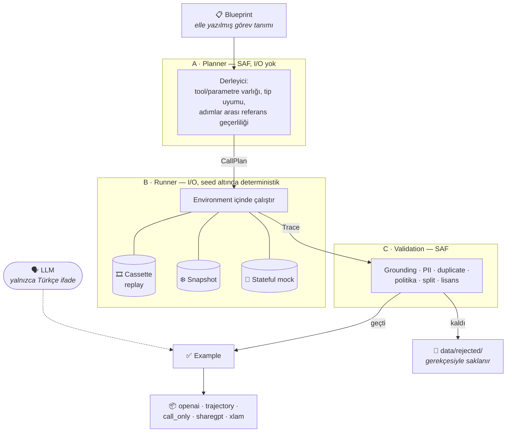

# ToolCall-TR

**A Verifiable Tool-Calling Data Generation Framework for Turkish and Turkey-Specific APIs**

Gerçek API şemalarından **execution-verified**, **observation-grounded** ve
**yeniden üretilebilir** Türkçe tool-calling veri setleri üreten açık kaynak bir
veri mühendisliği hattı.

> **Durum: Pilot v0.1 yayımlandı.** 200 doğrulanmış örnek (`turkey-200-v3`),
> 74 family, 15 sağlayıcı, 35 tool, 11 senaryo türünün hepsi, sıfır split
> sızıntısı. **Bu bir pilottur, benchmark değildir** — hedeflenen
> 10.000–15.000 örneklik tam sürüm henüz üretilmemiştir.
>
> 📦 **Veri seti:** [`bilalabic/toolcall-tr-pilot`](https://huggingface.co/datasets/bilalabic/toolcall-tr-pilot)

---

## Ayırt edici iddia

> Veri setindeki **her tool çağrısı gerçek bir implementasyon tarafından
> çalıştırıldı ve çıktısı doğrulandı. Hiçbir tool çıktısı bir LLM tarafından
> yazılmadı.**

Bu, "geçerli JSON üreten" bir sistem değildir. LLM yalnızca doğal Türkçe
kullanıcı ifadesini yazar; ground-truth tool çağrıları kod tarafından
deterministik olarak derlenir, gerçekten çalıştırılır ve bağımsız validator'lar
tarafından denetlenir.

| | Mevcut TR veri setleri | ToolCall-TR |
|---|---|---|
| Kaynak | Çeviri veya İngilizce tool kataloğu | Gerçek API şemaları |
| Tool çıktısı | LLM tarafından yazılmış | Gerçek çalıştırma ile üretilmiş |
| Doğrulama | Şema geçerliliği | Şema + execution + observation grounding |
| Yeniden üretilebilirlik | — | Cassette + donmuş saat + seed |

---

## Nasıl çalışır

Üç faz **asla tek adımda birleşmez.** Ayrım tasarımın merkezindedir: planlama
saftır ve ağa çıkmaz, çalıştırma deterministiktir, doğrulama yalnızca
kaydedilmiş çıktıyı okur.



**Neden bu ayrım:** validator'lar execution katmanını **import edemez** — böyle
bir bağımlılık `validation ↔ execution` döngüsü kurar ve CI'da `lint-imports`
ile patlar. Yeniden çalıştırma gerekiyorsa o bir runner adımıdır, validator
değil.

**LLM'in yeri kritik:** ok kesikli çizgidir çünkü LLM ground-truth üretmez.
Yalnızca doğal Türkçe kullanıcı cümlesini yazar. Üretici model tahminle değil
ölçülerek seçildi (`gpt-4.1-mini`); ayrıntı [`CLAUDE.md`](CLAUDE.md).

### Yeniden üretilebilirlik

Gerçek zamanlı bir API her çağrıda farklı veri döndürür — bu, doğrulanabilir bir
veri seti ile doğrudan çelişir. Çözüm bir **cassette (record/replay)**
katmanıdır: her HTTP yanıtı içerik-adresli kaydedilir, pipeline replay modunda
çalışır ve **CI ağa hiç çıkmaz**. Cassette anahtarı tool argümanından değil
**HTTP isteğinden** türetilir; tool şeması repodaki en oynak artefakt olduğu için
anahtarı ona bağlamak her şema değişikliğinde tüm kayıtları yetim bırakırdı.

Buna donmuş saat ve sıradan bağımsız seed türetimi eklendiğinde aynı girdi
birebir aynı `trace_id`'yi üretir.

---

## Sağlayıcılar

15 sağlayıcı, 35 tool — hepsi pilot korpusta gerçekten çağrılmıştır.

| Sağlayıcı | Mod | Lisans |
|---|---|---|
| MET Norway hava durumu | `live_recorded` | CC BY 4.0 |
| GeoNames Türkiye | `derived_local` | CC BY 4.0 |
| Frankfurter (`providers=ECB`) | `live_recorded` | ECB koşulları |
| USGS Earthquake | `live_recorded` | ABD kamu malı |
| World Bank WDI (`source=2`) | `live_recorded` + allowlist | CC BY 4.0 + WB koşulları |
| GBIF (CC0 / CC BY filtreli) | `live_recorded` | CC0 1.0 + CC BY 4.0 |
| Wikidata | `live_recorded` | CC0 1.0 |
| Wikimedia / Crossref / GitHub metadata | `live_recorded` | Yalnızca metadata |
| Resmî tatil snapshot'ı | `derived_local` | Kamu hukuku / resmî takvim |
| Hesaplama ve saat | `derived_local` | Apache-2.0 |
| `calendar_mock` sentetik takvim | `simulated` + **stateful** | Apache-2.0 |

**"Yalnızca metadata" bir cümle değil, bir mekanizmadır.** Normalizasyon
alanları beyaz listeler ve bir test hiçbir `extract`/`description`/`snippet`
anahtarının hayatta kalmadığını iddia eder. Wikipedia `extracts` ve REST
`summary` **CC BY-SA** (viral) olduğu için alınmaz; GitHub'dan yalnızca repo
istatistikleri alınır — `description`, README, issue/PR gövdeleri ve kullanıcı
login'leri **alınmaz**. Upstream bir şema değişikliği lisanslı metni sessizce
geri sokamaz.

**State gerçekten doğrulanır.** `calendar_mock/1.0.0` üzerinde 31 örnek
`initial_state_hash`/`final_state_hash` taşır ve 17'sinde state fiilen değişir.
Bu, onay→kabul→çağrı akışlarının (`confirmation_required`, `user_cancellation`)
gerçek bir durum makinesine karşı doğrulandığı anlamına gelir.

---

## Kurulum

```bash
uv sync --all-extras
```

```bash
uv run pytest -q
```

Testler ve varsayılan pipeline **API anahtarı olmadan** çalışır: HTTP çağrıları
cassette'lerden gelir, doğal dil üretimi deterministik template kullanır. OpenAI
kullanımı isteğe bağlıdır; model rolleri, ücretli çağrı onayı, bütçe/cache ve
ground-truth güven sınırları için
[`docs/OPENAI_INTEGRATION.md`](docs/OPENAI_INTEGRATION.md).

Yeni bir API/provider ekleme kontrol listesi:
[`docs/ADDING_API_PROVIDER.md`](docs/ADDING_API_PROVIDER.md).

## Kullanım

Uçtan uca üretim (ağ gerekmez):

```bash
uv run toolcall-tr generate
```

Fazları ayrı ayrı çalıştırmak için:

```bash
uv run toolcall-tr build-registry && uv run toolcall-tr plan && uv run toolcall-tr run && uv run toolcall-tr validate
```

Rapor ve denetim:

```bash
uv run toolcall-tr quality-report && uv run toolcall-tr stats && uv run toolcall-tr cassette verify
```

Dengeli bütçeyle canary korpusu:

```bash
uv run toolcall-tr generate-canary --profile smoke --target 100
```

Smoke profili yapısal pipeline'ı sınar; çıktısı tek başına eğitim/yayın onayı
değildir. Release profili tekrarları bloklar ve `semantic_valid`, `policy_valid`,
`language_valid` alanlarının tüm kayıtlarda `true` olmasını zorunlu tutar. Kota
planı karar, senaryo türü, zorluk ve split oranlarını API çağrısından **önce**
dengeler; hakem bir adayı reddederse ret nedeni aynı family'nin sonraki
üretimine onarım geri bildirimi olarak verilir.

Cassette kaydı **kasıtlı ve açık** bir eylemdir; hiçbir CLI komutu ağa çıkmaz:

```bash
uv run python scripts/record_met_cassettes.py
```

### Eğitim görünümleri

| Görünüm | İçerik |
|---|---|
| `openai_call_only` | İlk tool seçim kararında durur; observation yok |
| `openai_trajectory` | Tool çağrıları + observation + son observation'dan türetilmiş final yanıt |
| `openai` / `sharegpt` / `xlam` | Standart sohbet ve function-calling biçimleri |

`reasoning_summary_tr` yalnız kısa ve denetlenebilir bir karar özetidir; ham veya
gizli düşünce zinciri hiçbir görünüme eklenmez.

### Genelleme holdout profilleri

Varsayılan `standard` split family-disjoint davranışını korur ve train/test tool
ile sağlayıcı kesişimini raporlar. Canary komutunda ayrıca
`--holdout-profile unseen_tool` veya `--holdout-profile unseen_provider`
seçilebilir; seçilen eksende kesişim sıfır değilse kapı kapanır ve ölçüm
`generalization_report.json` içinde yayınlanır.

### Eğitime kapalı güvenlik eval'leri

Sentetik tool-output prompt-injection vakaları `data/evaluation/security/`
altındadır. Kullanıcı amacı, güvenilmez araç çıktısı, çıktıya gömülü talimat ve
beklenen davranış ayrı alanlardadır. Bu kayıtlarda `training_eligible=false`
şema tarafından zorlanır ve release manifesti `evaluation` ağacındaki bir
dosyanın eğitim girdisi olarak işaretlenmesini reddeder.

---

## Pilot v0.1 — `turkey-200-v3`

**200 doğrulanmış örnek · 74 family · 15 sağlayıcı · 35 tool · 0 reddedilen**

| Karar | Örnek | | Split | Örnek |
|---|---|---|---|---|
| `tool_call` | 143 (%71,5) | | train | 140 |
| `direct_answer` | 28 (%14,0) | | validation | 20 |
| `cannot_answer` | 21 (%10,5) | | test | 40 |
| `clarification` | 8 (%4,0) | | | |

**%28,5'i tool çağrısı içermez.** Bir tool-calling veri setinin en zor kısmı
modelin *ne zaman çağırmayacağını* öğretmektir.

11 senaryo türünün hepsi temsil edilir: `successful` 68, `sequential` 30,
`should_refuse` 21, `should_answer_directly` 17, `confirmation_required` 13,
`expected_error` 13, `user_cancellation` 11, `parallel` 11, `clarification` 8,
`empty_result` 4, `error_recovery` 4. 30 örnek çok turludur.

Split family düzeyinde ve fan-out'tan **önce** atanır; `hash(family_id)`'den
türetilir ve paraphrase'ler ait oldukları family'nin split'ini miras alır.
Sızıntı denetimi 0 ihlal verir.

### Neden 200'de duruldu

Daha büyük bir koşu yapıldı ve **reddedildi.** 1.000 örneklik üretim tamamlandı
ama yalnızca 20 family'den türetildiği için ~50× parametre fan-out gerekti ve
kompozisyon çöktü: %94,3 mutlu yol, 11 senaryo türünün 6'sı sıfır örnekle.
Kalite kapısı yeşil yandı çünkü bütçenin kendisi `tool_call` için
`minimum_ratio: 0.90` istiyordu — kapı doğru çalıştı, yanlış hedefe bakıyordu.

Darboğaz **ölçek değil fan-out oranıdır**: 20 family → 1.000 örnek (50×)
kompozisyonu çökertti, 74 family → 200 örnek (2,7×) çökertmedi. Altyapı
1.000 ölçeğinde çalıştığını kanıtladı.

### Sıradaki: 10.000–15.000 örnek

Dengeli 10.000 örnek ~3.700 family gerektirir; bugün 74 elle yazılmış blueprint
vardır. Bu, sentez motorunun (şablon + parametre ekseni + lockfile) çözmek için
tasarlandığı problemdir ve henüz uygulanmamıştır. Ayrıntı:
[kalite kurtarma planı](docs/QUALITY_RECOVERY_PLAN.md).

---

## Kişisel veri politikası

Sentetik kimlik numaraları kasıtlı olarak **geçersiz** aralıklardan üretilir:
TCKN'ler `0` ile başlar (gerçek bir TCKN başlayamaz), VKN'ler checksum-geçersiz,
IBAN'lar mod-97-geçersizdir. `PIIValidator` üretilen örnekleri tarar; gerçek
checksum'ı geçen herhangi bir tanımlayıcı CI'ı kırar.

> **Bilinen açık:** `ValidationContext.cassette_payloads` üretimde
> doldurulmuyor, dolayısıyla cassette'ler örnek doğrulaması sırasında
> **taranmıyor**. Planlanan yol çevrimdışı bir blob taramasıdır; blob başına bir
> kez çalışır ve ölçekte örnek başına tekrar taramadan ucuzdur.
>
> VKN checksum'ı zayıftır: rastgele 10 haneli sayıların ~%10'u geçer. Pilot v0.1
> üzerinde tarayıcı 12 bulgu üretti ve **hepsi yanlış pozitiftir** (GBIF
> occurrence ID'leri ve SHA-256 hash'lerinin içindeki hane dizileri). Gerçek
> TCKN/VKN/IBAN sayısı sıfırdır.

## Lisans

- **Kod:** Apache-2.0 — [`LICENSE`](LICENSE)
- **ToolCall-TR tarafından yazılan veri:** CC BY 4.0 — [`LICENSE-DATA`](LICENSE-DATA)

Tool gözlemleri kaynağının koşullarını taşır ve her `ToolSpec` kendi
`source.license` alanını içinde tutar; **tek tip bir lisans iddia edilmez.**
Kaynak bazlı atıf yükümlülükleri ve yapılan değişikliklerin listesi
`LICENSE-DATA` ile `legal/DATA_SOURCES.md` belgelerindedir.

## Atıf ve bağımsızlık

Bu proje Salesforce tarafından geliştirilmemiştir ve Salesforce ile bağlantısı
yoktur. APIGen, APIGen-MT, When2Call, ToolACE, ToolMind, BFCL ve τ-bench açıkça
atıf verilen metodolojik referanslardır; fikirleri yeniden uygulanmış,
artefaktları kopyalanmamıştır. Bkz. [`NOTICE.md`](NOTICE.md) ve
[`legal/CITATIONS.md`](legal/CITATIONS.md).
